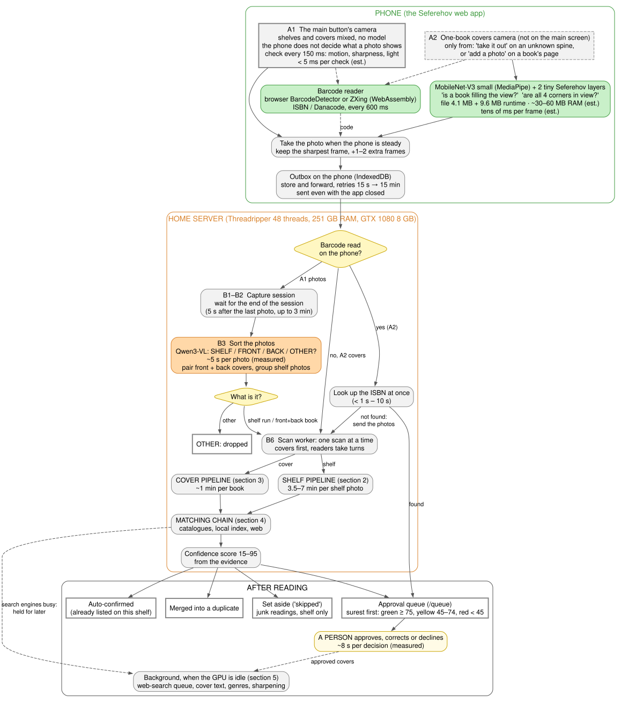
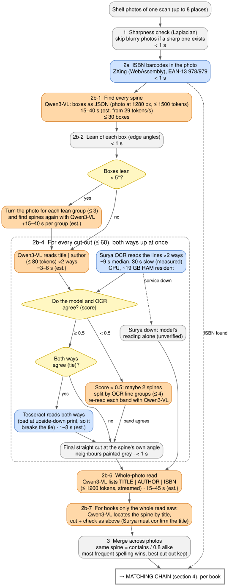
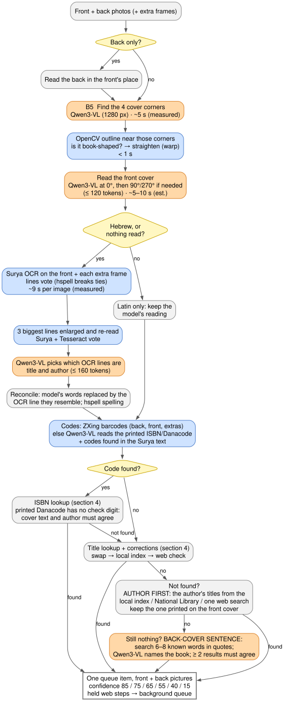
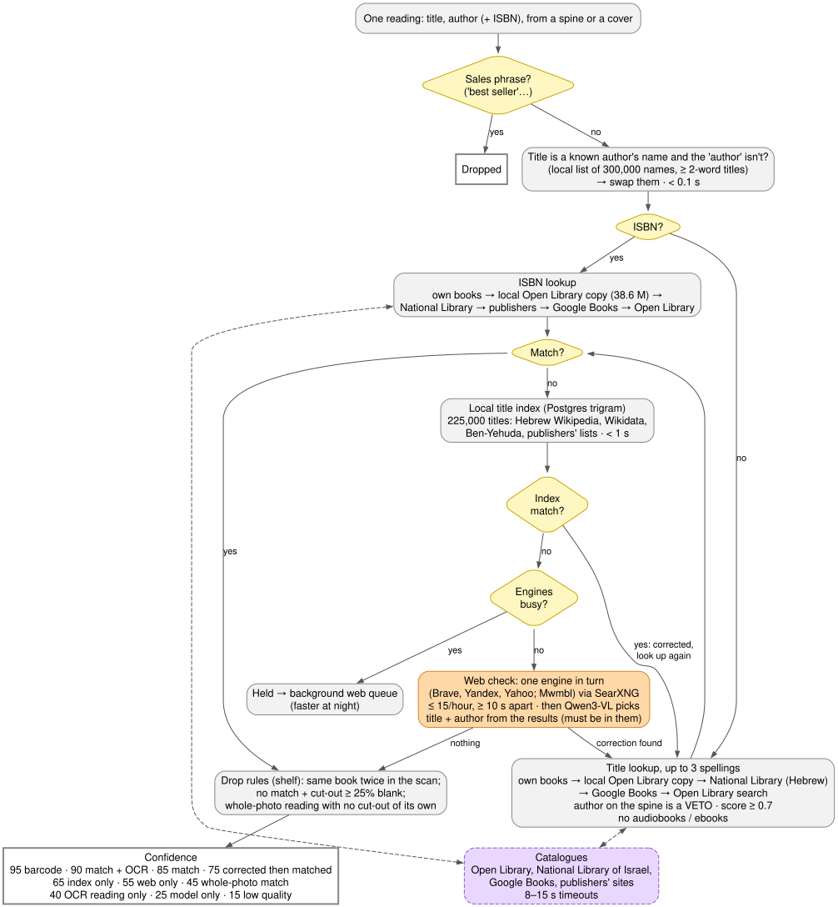
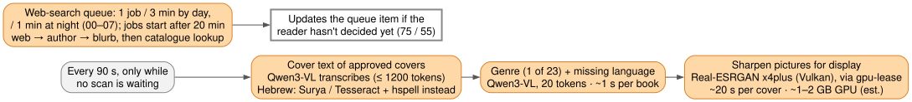

This document follows one scan from the phone camera to a book in the approval queue. It shows every step: which steps are plain code and which use a model, where each runs (phone or home server, GPU or CPU), how much memory each model takes, and how long each step takes.

**Measured** numbers come from the server on 10 November 2026: traces of 44 recent scans, the GPU queue, `ollama ps`, `nvidia-smi` and `ps`. **(est.)** marks an estimate. Estimates for Qwen3-VL are based on its measured speed on this card: about 29 output tokens a second, and about 270 prompt tokens a second.

# Summary

**What's in it:**

- **Overview:** phone, then home server, then where each book ends up.
- **One diagram each** for a shelf photo, a cover photo, the matching chain, and the background jobs.
- **Every branch is drawn:** barcode on the phone or not; what kind of photo it is; leaning spines; whether the AI model and the OCR agree; upside down; two spines in one cut-out; the OCR service being down; back cover only; Hebrew or Latin script; code found or not; search engines busy.
- **Colours:** grey is plain code, orange is a model on the server's graphics card, blue is a model on the server's CPU, green is a model on the phone, and purple is an outside service.
- **Each step shows** what it does, where it runs, and its time.
- **A table of all models and tools** at the end, with memory and time per call.

**Main findings:**

- **Qwen3-VL 8B** (graphics card) does most of the model work: sorting photos, finding and reading spines, reading covers, and choosing among search results. It takes 7.4 GB, but only 5.8 GB fits on the 8 GB card, so 1.6 GB runs from ordinary memory. It writes about 29 word-pieces (tokens) a second.
- **Surya OCR** runs on the CPU and uses about 19 GB of RAM. It takes 9 s per image typically and 30 s when slow.
- **One camera, sorted on the server:** the main button's camera takes shelves and covers alike, using no model, only plain code for steadiness and sharpness. Qwen3-VL on the server then decides, photo by photo, whether it is a shelf, a front or a back cover. The only model on the phone (MobileNet-V3 small, 4 MB) is in a one-book covers camera that opens only from a library's unknown spines or a book's page.
- **Time per scan:** a shelf photo takes 3.5 to 7 minutes and a cover about 1 minute.
- **Estimates** (marked "est."): the shelf steps' times, worked out from the model's speed, and the phone's, Tesseract's and Real-ESRGAN's memory.

# 1. The whole flow

## The phone

**The main button opens one camera for everything (A1).** Shelves, front covers and back covers go in any order, in one session. The phone **does not decide** what a photo shows and uses **no AI model**. Plain code checks the live picture every 150 ms: how much it moved since the last check, how sharp it is (the variance of the Laplacian), and how bright it is. A photo is taken when the picture has changed (moved along the shelf, a book turned over, the next book) and the phone is then held steady for about half a second. The sharpest full-size frame of that pause is kept, and if the phone is still steady a moment later, one extra frame is taken.

**The split happens on the server, photo by photo** (Branch 2 below): Qwen3-VL labels each photo SHELF, FRONT, BACK or OTHER, and plain code pairs fronts with backs. Until 3 Nov 2026 the phone guessed from its own movement (turned over = same book, moved sideways = next book), and it split three books into six, so the guess was dropped.

**A second, one-book camera (A2)** is not on the main screen. It opens only from two places: the 📷 "take it out" button next to a spine that no catalogue knew, on a library's page; and "add a photo" on a book's page. It expects the covers of one book, and runs the only model on the phone:

- **MobileNet-V3 small** (MediaPipe Image Embedder) turns each frame into 1,024 numbers.
- **Two tiny layers trained for Seferehov** sit on top. One answers "is a book filling the view?", the other "are all four corners of the cover in view?".
- The model file is 4.1 MB and the MediaPipe runtime is 9.6 MB. It runs on the phone's CPU in a background worker.
- In tests it found 92 of 92 book frames, with 1 false alarm in 127 frames. It accepted 91% of whole covers and caught 87% of cut-off ones.

Both cameras look for barcodes (ISBN and Danacode) with the browser's own reader, or with ZXing in WebAssembly where the browser has none.

Every photo goes into an **outbox on the phone** first and is sent from there. It is sent again if the network fails, even after the app is closed. The reader never presses a send button.

## The server

The home server has a 48-thread Threadripper, 251 GB of RAM and one **NVIDIA GTX 1080 with 8 GB**. Every GPU model call goes through the GPU queue (gpu.amiheines.com), so Seferehov never collides with other programs on the card.

**Branch 1: was a barcode read on the phone?** Then the ISBN is looked up at once, and a book that is found goes straight to the queue. Otherwise the photos go on.

**Branch 2: sorting (A1 photos only).** When a camera session ends, Qwen3-VL labels each photo: SHELF, FRONT cover, BACK cover or OTHER. That takes about 5 s per photo (measured). Plain code then pairs fronts with backs by colour and picture likeness, and asks the model "same book?" only when unsure. Shelf photos taken in a row become one shelf scan. OTHER photos are dropped.

**The scan worker** reads one scan at a time. Covers go first, because a person is usually waiting for them. Readers take turns, so one person's long session doesn't block everyone else.

# 2. Shelf photo

One shelf photo takes **3.5 to 7 minutes**, depending on how many spines it has. Most of that time goes to reading each spine twice (both ways up) with both Qwen3-VL and Surya.

Branches on this page:

- **Leaning books.** Boxes that lean more than 5° are grouped by angle (up to 3 groups). The whole photo is turned for each group, and the spines are found again.
- **Model and OCR disagree.** If the score is under 0.5, the cut-out may hold two spines. It is split along the OCR's line groups and each part is read again.
- **Upside down.** When both directions agree, Tesseract decides. It reads upside-down print very badly, which is exactly what makes it useful here.
- **Surya is down.** The model's reading is used alone and marked unverified.
- **Books the whole-photo read saw but the spine search missed.** The model locates them by title, and they get the same cut and check.

# 3. Cover photo

A cover takes about **1 minute** (measured traces: median a few seconds when the answer is quick, 56 s at the 90th percentile).

Branches on this page:

- **Back cover only.** It is read in the front cover's place.
- **Hebrew, or nothing read.** Surya OCR, a vote across frames, and a re-read of the biggest lines replace the model's own reading. Qwen3-VL only chooses which lines are the title and the author. Latin-script covers keep the model's reading.
- **A code was found.** The ISBN goes first. A Danacode read from print has no check digit, so its record must agree with the cover text and the author.
- **No match.** The chain is: title lookup and its corrections, then author first, then a sentence from the back cover searched word for word.

# 4. Matching chain (shared by shelves and covers)

Catalogues are tried in order: Seferehov's own books, the local copy of Open Library (38.6 million records, on the server), the National Library of Israel (Hebrew titles), Google Books, and Open Library online. The author read on the spine is a veto: a record by someone else is never taken.

The web check uses free search engines only, one at a time, through a self-hosted SearXNG. The limits are 15 searches an hour per engine, at least 10 s apart. When the engines are resting, the check is **held** and finishes later in the background.

## Where a book ends up

| Outcome | When |
|---|---|
| **Approval queue** | Every item a shelf or cover scan saves. Shown surest first: green at 75 or more, yellow at 45–74, red under 45. |
| **Auto-approved ("sure")** | Only when `AUTO_APPROVE_SURE=1` (off for now): a catalogue match confirmed by OCR, by the author read on the spine, with the record's main title, seen in two photos or more. See `CONFIDENCE_REVIEW.md`. |
| **Auto-confirmed** | A library shelf scan whose catalogue book is already listed on that shelf. |
| **Merged** | The same book seen twice: same book id, ISBN, Danacode, or a near title at the same library. |
| **Set aside ("skipped")** | Shelf readings with no catalogue match that look like junk: low quality, title equals author, a near copy of a book found in the same scan, or Hebrew with no dictionary word. Covers are never set aside. "Show skipped" brings them back. |
| **Dropped before saving** | Sales phrases, the same book twice in one scan, a badly cut spine with no match, and a whole-photo reading with no spine cut-out. |

A person then approves, corrects or declines each queue item. The median decision takes 8 s (measured over about 400 decisions).

# 5. Background work

These jobs run only while no scan is waiting, so they never slow down a reader.

# 6. Models and tools

**Models (they learned from data):**

- **Qwen3-VL 8B Instruct:** an open-weight vision-language model from Alibaba's Qwen team (2025). It takes text, images and video into one model, so it can look at a photo and answer questions about it in words: what the photo shows, where each spine is, what a spine says. The 8B version (8 billion parameters) is small enough for a home graphics card. It runs here through **Ollama**, a free program for running such models locally.
- **Surya OCR:** an open-source text-recognition toolkit (OCR) from Datalab, built on transformer models. It finds the lines of text in a picture and reads them, in over 90 languages including Hebrew. Unlike Qwen3-VL it only reads what is printed and doesn't invent text, which is why it is used to confirm the model's readings.
- **Tesseract:** the classic open-source OCR engine. It was started at HP in the 1980s and developed further by Google, and it has used a neural network (LSTM) for each line of text since version 4. It reads upside-down print badly, which makes it a good judge of which way up a spine is.
- **MobileNet-V3 small:** a small image-recognition network from Google (2019), made for phones. It turns a picture into 1,024 numbers that describe it. Seferehov runs it through Google's **MediaPipe** library, with two tiny layers of its own trained on top.
- **Real-ESRGAN x4plus:** an open-source model from Tencent ARC (2021) that enlarges and sharpens photos (super-resolution). Here it runs in its ncnn build, on the graphics card through Vulkan.

**Tools (plain code, no learning):**

- **hspell:** a free Hebrew spell-checker and word analyser. It knows which Hebrew words exist, so it can tell a misread title from a real one.
- **ZXing ("zebra crossing"):** Google's open-source barcode reader, here compiled to WebAssembly so it runs in the browser and on the server.
- **OpenCV.js:** the OpenCV computer-vision library compiled to JavaScript. It finds a cover's outline and straightens it.
- **Postgres trigram search (pg_trgm):** a database extension that compares texts by their three-letter pieces, so a title with a misread letter still finds the right record.
- **SearXNG:** a free, self-hosted metasearch engine. It sends one query to several public search engines and collects their results without tracking.

## Memory and time

| Model / tool | What it is for | Where it runs | Memory | Time per call |
|---|---|---|---|---|
| MobileNet-V3 small + 2 Seferehov layers | Covers camera: is a book filling the view? are all corners in? | Phone CPU (web worker) | 4.1 MB file + 9.6 MB runtime; ~30–60 MB RAM (est.) | tens of ms per frame (est.) |
| Barcode reader (browser or ZXing WebAssembly) | ISBN / Danacode, live | Phone CPU | small | every 600 ms |
| **Qwen3-VL 8B instruct** (Ollama) | Sorting photos, cover corners, finding spines, reading spines and covers, choosing OCR lines, reading printed codes, choosing web results, cover text, genres | Server GPU, via the GPU queue | **7.4 GB in all: 5.8 GB on the GPU + 1.6 GB in system RAM** (measured, 8,192-token context); file 6.1 GB | ~29 tokens/s; 3–40 s depending on the job (see sections 2–4); loading ~6 s when cold (measured) |
| Surya OCR 0.17 (PyTorch, CPU) | Hebrew and Latin text lines with positions; confirms what the model read | Server CPU (38 cores, low priority, one image at a time) | **~19 GB RAM** resident (measured) | median 9 s, slow 30 s per image (measured) |
| Tesseract (heb+eng) | Which way is up; re-reading big cover lines; fallback cover text | Server CPU | ~100–200 MB (est.) | 1–3 s (est.) |
| hspell | Hebrew dictionary: spelling votes, fixes, junk filter | Server CPU | small | ms |
| ZXing (WebAssembly) | Barcodes in uploaded photos | Server CPU | small | < 1 s |
| OpenCV.js | Cover outline and straightening | Server CPU | small | < 1 s |
| Real-ESRGAN x4plus (ncnn, Vulkan) | Sharpening pictures for display, after approval | Server GPU, via `gpu-lease` | ~1–2 GB GPU (est.) | ~20 s per cover |
| Postgres trigram search | Local Open Library copy (38.6 M records), title index (225,000 titles, 300,000 names) | Server CPU / database | in the database | < 1 s |
| SearXNG → Brave, Yandex, Yahoo, Mwmbl | Web search to fix misread titles | Outside services | — | ≥ 10 s apart |

No paid AI service is called by the app. Claude is used only to develop it.

# 7. Notes

- Qwen3-VL doesn't fit entirely in the card's 8 GB together with its 8,192-token context, so about 1.6 GB of it runs from system RAM. That is one reason long outputs (finding 30 spines, reading a whole shelf) are the slowest steps.
- Surya runs on the CPU on purpose. It would compete with Qwen3-VL for the 8 GB card, and the server has 48 threads to spare.
- Inside one cut-out, the two directions are read in parallel: two model calls and two OCR calls at once. Everything else runs one scan at a time.
- The older shelf-upload and video routes still exist on the server, but the app no longer uses them. Shelf photos arrive only through the "Photograph books" camera.
